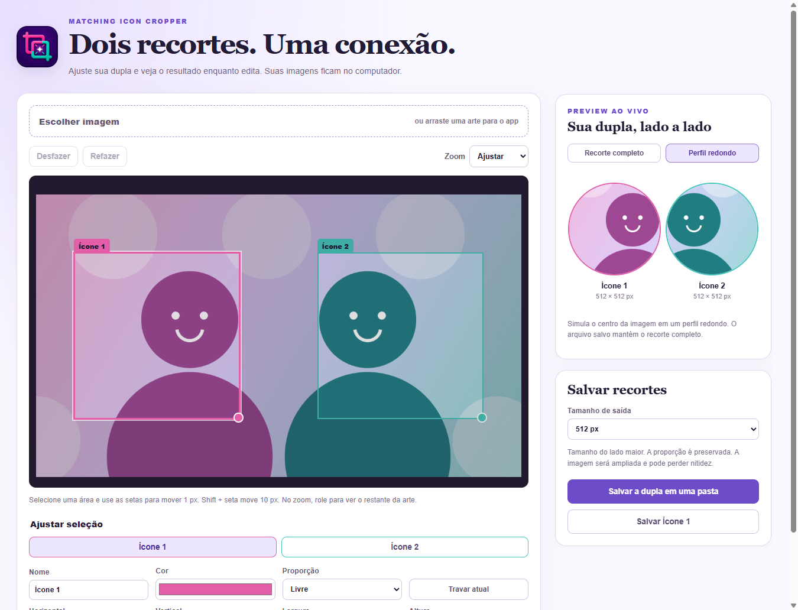

# Matching Icon Cropper

Create matching profile pictures from the same artwork. A portable Windows app with a live side-by-side preview, custom crop ratios and animated GIF support.

[Download for Windows x64](https://github.com/GabiZips/matching-icon-cropper/releases/latest) · [Português](#português) · [Report an issue](https://github.com/GabiZips/matching-icon-cropper/issues)



## Features

- Two independent crops with editable names and colors.
- Live preview next to the artwork, with full-rectangle and round-profile views.
- Drag and drop PNG, JPG, WebP or GIF files. Everything stays on your computer.
- Free proportions or locked `1:1`, `3:4`, `4:3`, `9:16` and `16:9`.
- Zoom, undo/redo and pixel-precise arrow-key movement.
- Original size or a longest side of 256, 512, 1024 or 2048 px, preserving proportions.
- Save both pictures into one folder; confirm before replacing existing files.
- Animated GIF export with progress and cancellation, preserving frame timing, transparency and loop count.

## Using the app

1. Download the latest `Matching.Icon.Cropper-*-portable.exe` from Releases and open it. No installation or Node.js is needed to use the executable.
2. Drop your artwork into the window or click **Escolher imagem**.
3. Move the two crop areas and resize using the lower-right handle. Select a ratio or unlock it for independent width and height.
4. Check the preview, choose the output size and click **Salvar a dupla em uma pasta**.

The round preview simulates a profile-picture mask. Saved files retain the full rectangular crop. Enlarging a small crop does not add detail. GIF uses a 256-color palette, so slight color differences may occur. The interface is currently in Portuguese.

| Shortcut | Action |
| --- | --- |
| Arrow keys, after selecting a crop | Move 1 px |
| Shift + arrow | Move 10 px |
| Ctrl + Z | Undo |
| Ctrl + Shift + Z or Ctrl + Y | Redo |

## Development

Use Node.js 24 or newer on Windows.

```sh
npm ci
npm run dev
```

```sh
npm test
npm run test:app
npm run package
```

`test:app` runs the real production renderer and export worker in a hidden Electron window. It verifies exported PNG pixels/dimensions, GIF transparency/disposal/timing/looping, invalid files, undo/redo, keyboard movement, cancellation and preview mapping. Packaging writes the portable executable to `release/`.

Source: `src/` is the React editor and export worker; `electron/` contains the sandboxed desktop window and native save dialogs. Generated output, dependencies and local environment files are ignored by Git.

## Português

Crie duas fotos de perfil combinando a partir da mesma arte. O aplicativo funciona localmente no Windows e preserva a animação de GIFs.

**[Baixar aplicativo para Windows](https://github.com/GabiZips/matching-icon-cropper/releases/latest)**

Arraste a imagem para o app, ajuste as duas áreas e acompanhe o preview ao lado. Escolha entre proporções fixas ou livres, use o zoom e as setas para acertar detalhes e desfaça/refaça alterações quando precisar.

O modo redondo simula o centro da imagem em uma foto de perfil; os arquivos exportados mantêm o recorte completo. Escolha o tamanho do lado maior, salve a dupla em uma pasta ou exporte apenas o ícone selecionado. Em GIFs, é possível acompanhar o progresso e cancelar o processamento.

As imagens não são enviadas para a internet. PNG, JPG, WebP e GIF são aceitos, com limite de entrada de 100 MB e 40 megapixels. O histórico de edição é reiniciado ao carregar outra arte.

## License

MIT — see [LICENSE](LICENSE). Bundled library licenses are collected in [THIRD-PARTY-NOTICES.txt](THIRD-PARTY-NOTICES.txt); Electron/Chromium license files accompany the executable distribution.
